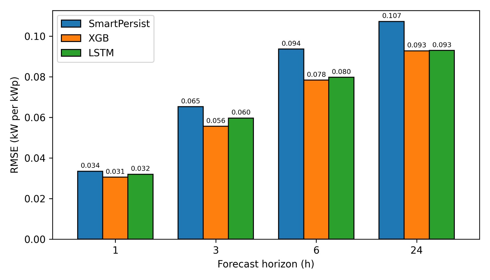

# Multi-Horizon Solar PV Forecasting for Noakhali, Bangladesh

Forecasting PV power 1, 3, 6 and 24 hours ahead for Noakhali (22.87°N, 91.10°E) using
10 years of open weather data, and comparing **XGBoost** and **LSTM** against a
**smart persistence** baseline.

## Approach
- **Data:** hourly NASA POWER data, 2015–2024 (GHI, clear-sky GHI, temperature, humidity, wind, pressure) — 87,671 samples.
- **PV output:** simulated with `pvlib` for a 1 kWp system (tilt 23°, south-facing; Erbs → Faiman → PVWatts). *Not measured plant data.*
- **Target:** ratio of PV power to clear-sky PV power, then multiplied back by clear-sky power.
- **Baseline:** smart persistence = last daylight clear-sky index × clear-sky PV at the target hour.
- **Evaluation:** chronological 80/20 split, 5-fold expanding-window cross-validation (XGBoost), seasonal analysis. Metrics are computed on daytime hours only.

## Results (test set, RMSE in kW per kWp)

| Horizon | Smart persistence | XGBoost | LSTM | XGBoost skill | LSTM skill |
|---|---|---|---|---|---|
| 1 h | 0.0335 | **0.0306** | 0.0320 | 8.8% | 4.7% |
| 3 h | 0.0653 | **0.0556** | 0.0597 | 15.0% | 8.7% |
| 6 h | 0.0937 | **0.0784** | 0.0798 | 16.3% | 14.9% |
| 24 h | 0.1073 | **0.0928** | 0.0930 | 13.5% | 13.3% |

Skill = 1 − RMSE_model / RMSE_smart-persistence. 5-fold cross-validation of XGBoost gives 8.0–14.6% skill (`cv_results.csv`).



**Key findings**
- XGBoost is as good as or better than LSTM at every horizon.
- Errors are lowest in the dry season and highest at 6 h and 24 h in the monsoon (`season_results.csv`).
- In the pre-monsoon season, XGBoost gives almost no gain over smart persistence at 1–3 h.
- A plain persistence baseline would greatly overstate the benefit (RMSE 0.406 at 6 h vs 0.094 for smart persistence).

## Run
```bash
pip install -r requirements.txt
python solar_forecasting_noakhali.py
```
Works in Google Colab too (needs internet for the NASA POWER download). Set `RUN_LSTM = False` in the script to skip the slow LSTM part.

## Files
| File | Content |
|---|---|
| `solar_forecasting_noakhali.py` | full pipeline |
| `holdout_results.csv` | hold-out test results |
| `cv_results.csv` | 5-fold cross-validation (XGBoost) |
| `season_results.csv` | seasonal results (XGBoost) |
| `rmse_comparison.jpg` | RMSE figure |

## Limitations
PV output is simulated, NASA POWER is satellite/reanalysis-based, one site only, LSTM trained once (single seed), deterministic forecasts only.

## Status
Paper in preparation.
